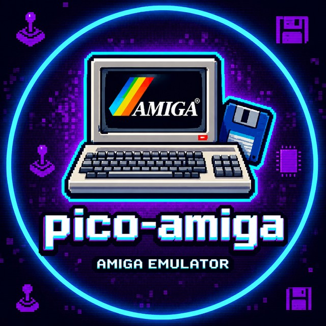

# pico-amiga



An Amiga 500 / 500+ (OCS / ECS, PAL) emulator for RP2350 boards with QSPI
PSRAM, in the family of [pico-speccy](https://github.com/drewpo28/pico-speccy):
same boards, same drivers, same menu.

It runs on real hardware: Kickstart 1.2 - 3.1, Workbench, AROS, DiagROM, games
and demos from ADF and DMS images (IK+, Cannon Fodder, Dune II, RoboCop 1 and 2,
Barbarian, Zynaps, Spaceballs' State of the Art among those checked), with
picture and sound over HDMI, or picture over VGA.

## What it emulates

| | |
|---|---|
| A500 | 68000 at 7.09 MHz, OCS, 512 KB chip RAM + 512 KB slow RAM |
| A500+ | ECS (super-hires, the 8375 Agnus / 8373 Denise IDs), 1 MB chip RAM, battery clock |
| Display | lowres, hires at its full 640 pixels, HAM, interlace with both fields, sprites, copper, blitter |
| Sound | Paula, 4 DMA channels |
| Disks | DF0-DF3: ADF streamed from the SD card and written back to it; DMS unpacked into PSRAM (write-protected); `.m3u` disk sets |
| Kickstart | built into the firmware (see [Building](#building)) or any 256 / 512 KB ROM file from the card |

The 68000 is [Musashi](https://github.com/kstenerud/Musashi); A600 and A1200
(AGA, 68020) are not there yet - [docs/PLAN.md](docs/PLAN.md) has what is
missing and in which order.

## Hardware

| | |
|---|---|
| MCU | RP2350 (A or B). It starts at 252 MHz; set **504 MHz** in Options > Overclock: at 252 and 378 full speed is not guaranteed, most likely they are too slow for the emulation |
| PSRAM | 8 MB QSPI PSRAM on XIP CS1 |
| Video | HDMI/DVI through HSTX (display on GPIO 12-19) or a PIO TMDS serializer, with HDMI audio; or VGA, detected at boot |
| Storage | SD card (FatFs) |
| Input | USB keyboard, mouse and gamepads (HID, XInput), PS/2 keyboard, NES / SNES pads |
| Audio | HDMI, I2S DAC (PCM5102 / PCM5122) or PWM |

| Board | `-DBOARD=` | Video |
|---|---|---|
| Murmulator 1.x | `MURM` | PIO |
| Murmulator 2.0 | `MURM2` (default) | HSTX |
| Olimex RP2040-PICO-PC + Pico 2 | `PICO_PC` | HSTX (red and green lanes swapped) |
| Pimoroni Pico DV Demo Base + Pico Plus 2 | `PICO_DV` | PIO (SD on PIO SPI) |
| Waveshare RP2350-PiZero | `ZERO2` | PIO |

The carriers also take a W module: `_W` for a Pico 2 W / Pico Plus 2 W, `_WS`
for the Waveshare RP2350B-Plus-W (`-DBOARD=MURM2_W`, ...; the radio is not
used). Pin maps are pico-speccy's (`cmake/boards.cmake`).

## Video modes

Video > Output > Mode, kept only after you confirm it (otherwise the old mode is back
after 15 s):

| Mode | Picture | Notes |
|---|---|---|
| 640x480 at 60 Hz (default) | 320 x 240 of the screen | every display takes it |
| 720x480 at 60 Hz | 360 x 240 | the full width with its overscan |
| 800x600 at 60 Hz | all of it, framed | HDMI at 378 / 504 MHz (VGA: the 800x600 below) |
| 720x576 at 50 Hz | all of it | the Amiga's own rate: smooth scrolling |
| 800x600 at 50 Hz | all of it, framed | 60 Hz on VGA |

The Amiga makes 50 frames a second; a 60 Hz mode shows them with a little
judder. A 50 Hz mode is the smooth one, if the display takes it. The menu
describes each mode beside the list.

## SD card

```
/amiga/            a good place for disks (.adf, .dms, .m3u sets) and Kickstart files;
                   the menu's file browser reaches the whole card
/amiga/df0.adf     goes into DF0 by itself if nothing else was picked
/.config/pico-amiga/<board>/storage.nvs   the settings (pico-speccy's format)
```

A Kickstart picked from the card (Machine > Custom ROM) can have a 512 KB
`ext.rom` beside it (AROS needs one). An `.m3u` is a list of disk files, one per
line (as RetroArch reads them); Devices > Disks > Floppy drives "Auto" gives
each disk of a set its own drive, and Ctrl+F12 swaps them. A `#DRIVES:n` line in
the `.m3u` (1-4) makes Auto connect n drives instead: for games that read DF0 only
or run short of memory with more drives (Gobliiins: `#DRIVES:1`).

If the board cannot start, the screen turns one colour and the LED blinks:
red = no PSRAM, magenta = no ROM and no SD card, blue = no ROM.

## Keys

F1-F10 are the Amiga's. The rest follow WinUAE and pico-speccy:

| Key | |
|---|---|
| F12 | the menu: Help, Machine, Devices (disks, input), Video, Audio, Options, Reset, Debug |
| Ctrl+F12 | pick the disk in DF0 |
| F11 or Shift+F12 | reset the Amiga |
| Win+F11 | reboot the board |
| Win+F5 | open a file: a disk (F5 picks DF0-DF3, F1 shows what is on it, F9 makes a blank ADF), an `.m3u` set or a Kickstart |
| Win+F8 | performance band, with the drive's track and sector |
| Win+F1 | system info: board, memory, temperature |

Devices > Input has the cursor keys as a joystick, the mouse speed and buttons.

## Building

Firmware (Pico SDK 2.x and an Arm toolchain):

```sh
cmake -B build -DPICO_SDK_PATH=/path/to/pico-sdk -DBOARD=MURM2   # MURM, PICO_PC, PICO_DV, ZERO2, ..._W
cmake --build build -j
# -> build/m2p2-amiga-0.1.0.uf2
```

The board starts at 252 MHz (`-DCPU_MHZ`, the clock of a fresh card); switch to
504 in Options > Overclock for full speed.

`./build_all.sh` builds every board into `firmware/` (one UF2 per
board: HDMI or VGA is picked at boot); `./check-release.sh` then checks each
image's heap and runs the host tests.

The Kickstarts in the Machine menu (DiagROM; A500: 1.2, 1.3, 2.04, 2.05, 3.1;
A500+: 2.04, 2.05, 3.1) are linked into the firmware from `-DROMS_DIR` (default
`debug/`) when their files are there: `cmake/roms.cmake` lists the file names.
They are Commodore's and are not in this repository; without them the firmware
boots any ROM file from the card.

On a PC (SDL2), the same firmware with the card as a folder, and the headless
test bench:

```sh
cmake -S host -B build-host && cmake --build build-host -j
build-host/pico-amiga --root ~/pico-amiga          # the folder holds amiga/ as the card does
host/tests/fetch_test_roms.sh roms                 # AROS + DiagROM, from the vAmiga repository
host/tests/smoke.sh roms                           # DiagROM, keyboard, audio, AROS, ECS
build-host/pico-amiga-host --rom kick.rom --adf game.adf --frames 1500 --shot 1500:game.png
```

`pico-amiga-host` writes framebuffer snapshots (`--shot N:file.png`), Paula
output (`--wav`), prints SERDAT to stdout, presses keys, moves the joystick and
the mouse (`--key`, `--joy`, `--mouse`) and swaps disks (`--swap`).

## How it is built

```
src/amiga/     the emulator: platform-independent C11, shared by the firmware and the PC builds
  amiga.c        reset, line/frame scheduler, 68000 glue, keyboard controller
  mem.c          24-bit map in 64 KB banks, Musashi memory callbacks
  custom.c       $DFF000 register file: DMACON, INTENA/INTREQ, beam, ports
  copper.c       MOVE/WAIT/SKIP against the beam
  blitter.c      area mode (shift, masks, minterms, fill) and line mode
  denise.c       bitplane and sprite DMA, the pixel pipeline (fetch and output stages)
  paula.c        4-channel DMA audio
  cia.c          two 8520s (timers, TOD, ICR, keyboard serial port)
  floppy.c       drives, ADF <-> MFM track codec, disk DMA
  rtc.c          the A500+ battery clock
src/pico/      RP2350 firmware: video (HSTX, PIO HDMI, VGA), HDMI audio, PSRAM,
               clocks, input, disks and DMS, ui/ (the menu, pico-speccy's)
host/          the PC builds (SDL2 firmware, test bench) and the tests
external/      Musashi (+ generated tables), FatFs, TinyUSB
tools/         code generators, board debugging from VS Code
docs/PLAN.md   what is missing and in which order
```

The main ideas are in the file headers and in CLAUDE.md; in short:

* **CPU**: Musashi, configured as a plain 68000. Its jump and cycle tables are
  turned into const arrays by `tools/gen_musashi.py`, and the 250 hottest
  handlers run from SRAM. Musashi's 68000 test suite passes (59 of 60; `move.bin`
  fails the same way on stock Musashi in 68000 mode).
* **Time**: a line is 227 colour clocks; the copper and the CPU take turns, and
  every display-register write carries its own beam position.
* **Display**: Denise is a queue of events (line starts, register writes) that
  two stages replay, bitplane fetch and pixel output, on the second core while
  the first runs the emulation. A frame starts when the scanout is 70% into its
  picture, so the picture is never cut by the beam.
* **Framebuffer** (SRAM, ~245 KB): 288 rows, each in the form its line needs -
  360 direct 12-bit colours (lowres, HAM), 720 indices into a 64-colour row
  palette (hires), or two 720 x 4-bit lines with 16 colours each (interlace,
  both fields).
* **HDMI on PIO**: a line goes out by lookup - entry numbers that DMA turns into
  TMDS words - so the CPU only encodes each new colour of a line.
* **Memory**: chip RAM, slow RAM and the DMS work area live in PSRAM, memory-mapped
  through the XIP cache; a built-in Kickstart is read in place from flash.

## Authors

(C) 2026 Drew and Claude (Anthropic), written together: design, emulation,
firmware and testing. The same text, with the logo, is in the menu under
Help > About.

## Credits and licences

GPL-3.0 (see LICENSE), like pico-speccy, whose drivers, menu, PSRAM, clock and
board code and PC host build this reuses (the PIO TMDS pin format and balanced
character pairs, `tmds_pair.h`, are pico-speccy's too). Third-party parts keep
their licences:

| Part | Authors |
|---|---|
| 68000 core | [Musashi](https://github.com/kstenerud/Musashi) (MIT), Karl Stenerud |
| DMS unpacker | xDMS 1.3 (public domain), Andre Rodrigues de la Rocha, Heikki Orsila |
| File system | FatFs, ChaN |
| SD card driver | Elehobica (BSD-2, via pico-speccy) |
| USB host | TinyUSB (MIT), Ha Thach; XInput from usb64 (MIT), Ryan Wendland |
| Keyboard queue | FabGL, Fabrizio Di Vittorio |
| PS/2, VGA | the Murmulator community |
| I2S audio | Vincent Mistler (MIT) |
| HSTX scanout structure | Raspberry Pi pico-examples (BSD-3) |

Hardware behaviour was checked against the Amiga Hardware Reference Manual and,
where it is vague, against how vAmiga (Dirk W. Hoffmann) and WinUAE (Toni Wilen)
model it; AROS and DiagROM are the test software. Kickstart is (C)
Commodore-Amiga and Cloanto; Amiga is a trademark of its owners. The logo
(`img/logo.jpg`, the About page's copy is made by `tools/gen_logo.py`) is the
project's.
